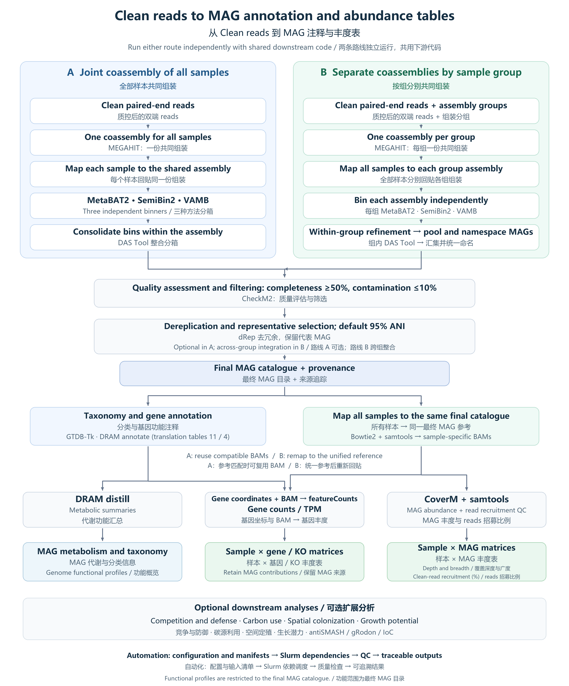

[English](README.md) | 中文



# MAG workflow

Clean paired-end reads → assembly → binning → MAG catalogue → annotation → abundance tables.

代码统一放在 `scripts/`，日志在独立的 `logs/`。两种组装策略共用下游脚本，
不混合不同项目的数据。不重复做质控剪切或 reads 去重复。

## 使用

软件模块、数据库和集群资源集中在 `config.json`，同一集群通常只配置一次。
首次运行先复制配置模板：`cp config.example.json config.json`，再填写本地软件环境和数据库路径。
需要 Python 3.8+；VAMB 需支持 5.x 的 `vamb bin default`。
DRAM 默认使用 `$HOME/DRAM_CONFIG`，沿用已跑通的数据库配置，不额外下载/重建数据库。

**共同组装**：仅更换输入目录。

```bash
# 默认预览，不提交任务
bash scripts/run_joint.sh /path/to/clean_data

# 提交完整流程
bash scripts/run_joint.sh /path/to/clean_data --submit
```

输入可平铺，也可放在子文件夹中，所有样本会放在一份共同组装里。
支持 `sample_R1.fq.gz`、`sample_R1_001.fastq.gz`、`sample_good_1.fq.gz`、
`sample_1.fastq.gz` 及对应的 R2/2，也支持未压缩 `.fq/.fastq`。
每对文件视为一个样本；多 lane 数据需在上游按样本合并。

**分组共同组装**：文件夹表示组装分组，不是每个样本一个文件夹。

```text
clean_data/
├── group_A/
│   ├── sample01_R1.fq.gz
│   └── sample01_R2.fq.gz
└── group_B/
    ├── sample02_R1.fq.gz
    └── sample02_R2.fq.gz
```

```bash
bash scripts/run_grouped.sh /path/to/clean_data
bash scripts/run_grouped.sh /path/to/clean_data --submit
```

每组分别组装；所有样本回贴每份组装后分箱。组内 DAS Tool 整合后，
统一汇集 MAG、CheckM2 筛选，再使用 dRep 跨组去冗余。
样本 ID 必须在全项目中唯一。组装分组不自动等同于后续统计的处理分组。

如果 reads 平铺但需要分组，可在输入目录放一份 `samples.tsv`：

```text
sample	r1	r2	group
sample01	sample01_R1.fq.gz	sample01_R2.fq.gz	group_A
sample02	sample02_R1.fq.gz	sample02_R2.fq.gz	group_B
```

使用实际 TAB 分隔。路径相对于 samples.tsv，也可以是绝对路径。
也可直接把 samples.tsv 路径作为输入。无须移动或复制大体积 reads。
生物学分组必须来自目录或样本表，不能从平铺 reads 自动推断。

## 分段运行

在上述命令后加 `--stage 阶段`。不加时为完整流程。

| 阶段 | 执行内容 |
|---|---|
| `assembly` | 只做 MEGAHIT 组装 |
| `assembly_continue` | MEGAHIT 原目录续跑；沿用原参数 |
| `binning` | 组装索引 → 回贴 → 三工具分箱 → DAS Tool → MAG 目录 |
| `quality` | 汇集 DAS Tool MAG → CheckM2 → 质量筛选 |
| `catalog` | 接续 quality；分组路线 dRep → 建立最终目录 |
| `annotate` | 独立提交 GTDB 和 DRAM，不包括 distill |
| `taxonomy` | 仅 GTDB |
| `dram` | 仅 DRAM annotate 和注释合并 |
| `distill` | 仅 DRAM 代谢汇总 |
| `quantify` | 最终 MAG 索引 → 全样本回贴 → MAG/基因/KO 丰度表 |
| `tables` | 使用已有 DRAM 和最终参考 BAM，只计算丰度表 |

分段示例：

```bash
bash scripts/run_joint.sh /path/to/clean_data --stage assembly --submit
# 组装成功后
bash scripts/run_joint.sh /path/to/clean_data --stage binning --submit
# MAG 目录建立成功后
bash scripts/run_joint.sh /path/to/clean_data --stage annotate --submit
# DRAM 成功后可分别做代谢汇总与丰度
bash scripts/run_joint.sh /path/to/clean_data --stage distill --submit
bash scripts/run_joint.sh /path/to/clean_data --stage quantify --submit
```

同一段内自动使用 Slurm `afterok` 依赖。分段之间由用户确认上一段成功再提交，
也可用 `--after 上游jobID` 连接。完整流程中，GTDB、DRAM 和最终参考回贴分支可并行。
每次提交在 `scripts/.runs/` 保存脚本和样本清单副本，排队期间不会读到之后的代码改动。

## 默认结果与日志位置

若输入为 `/project/clean_data`：

```text
/project/MAG_results/clean_data_joint/     # 或 clean_data_grouped
├── assembly/<group>/final.contigs.fa
├── groups/<group>/
│   ├── bam/
│   ├── metabat2/
│   ├── semibin2/
│   ├── vamb/
│   └── dastool/final_DASTool_bins/
├── merged_MAGs/
├── checkm2/
├── passing_MAGs/
├── drep/                                # 分组路线
├── analysis/
│   ├── filtered_MAGs/
│   ├── filtered_MAGs_table11/ 和 table4/
│   ├── DRAM_table11/ 和 DRAM_table4/
│   ├── all_gene_annotations.tsv
│   └── gene_to_MAG.tsv
├── gtdb/
├── distill/
├── catalogue_index/
├── catalogue_bam/
├── tables/
├── MAG_provenance.tsv
└── contig_provenance.tsv

MAG_workflow/logs/<数据集>_<策略>/<提交时间>/
├── *.out / *.err                        # Slurm stdout/stderr
├── *.bowtie2.log
├── jobs.tsv
└── native/                              # 工具内置日志，原位置保留链接

MAG_workflow/scripts/.runs/<数据集>/<提交时间>/  # 当次提交的代码和配置副本
```

首次输出路径固定，便于分段衔接；需要新一轮分析时加 `--run-dir /new/result/path`。
已有主要结果时停止，不自动删除/覆盖，也不会自动改目录绕开失败。
失败时只提交受影响阶段，先将失败的部分结果改名保留。不要重复提交同一个仍在运行的阶段。
DRAM 和 distill 会跳过由本套脚本写入 `.done` 的成功分组，不删除旧目录。
`jobs.tsv` 保留已提交 job ID；如果提交中途失败，已有作业可能仍在排队。

## 复用已有结果

已有组装：`--stage binning --assembly-root /existing/assemblies`，
目录应为 `<group>/final.contigs.fa`，共同组装组名为 `all`。
可以通过软链接对接旧目录，不复制序列。

已有 DRAM 与可匹配 BAM：

```bash
bash scripts/run_joint.sh /path/to/clean_data --stage tables \
  --analysis-dir /path/to/existing_analysis \
  --bam-dir /existing/mapped_reads \
  --run-dir /new/table_results --submit
```

该输入应包含 filtered_MAGs/、DRAM_table11/ 和有数据时的 DRAM_table4/。
旧 BAM 必须与注释使用相同 contig 序列、ID 和坐标。
不会把多份旧 assembly 的 BAM 直接合并为一个统一 MAG 丰度表。

## 主要输出表

新增 `13_read_recruitment.sh`：`all` 和 `quantify` 自动计算，不依赖 DRAM 出表。
结果为 `read_recruitment/sample_MAG_read_recruitment.tsv`，其中
`MAG_mapped_percent` 表示落在最终 MAG 目录 contig 上的 primary mapped reads
占全部输入 clean reads 的百分比；`MAG_mapped_percent_MAPQ20` 加上 MAPQ≥20 筛选。
R1/R2 各算一条，分母包含未比对 reads，分子排除 secondary/supplementary。
统计全部保留 MAG，不使用 CoverM 的样本内检出阈值；该比例不代表细胞比例，也不直接用于校正 KO 丰度。

已有结果只补这一项（分组路线改用 `run_grouped.sh`）：

```bash
bash scripts/run_joint.sh /path/to/clean_data --stage recruitment \
  --run-dir /path/to/existing_run --submit
```

可用 `--bam-dir`、`--analysis-dir` 指向旧结果。新比对会在 BAM 旁保存
`<sample>.input_reads.json` 输入计数，日志仍单独保存；旧 BAM 没有该计数时，
仅此阶段自动统计输入 FASTQ 的记录数（四行一条，可 gzip 压缩）。
因此即使 BAM 用了 `--no-unal`，分母也不会缩小；输入 reads 必须与 BAM 来源相同。

- `sample_x_MAG_relative_within_catalogue.tsv`：样本 × MAG，目录内相对丰度。
- `sample_x_MAG_mean_coverage.tsv`、`sample_x_MAG_covered_fraction.tsv`：覆盖深度、广度。
- `sample_x_gene_counts.tsv`、`sample_x_gene_TPM_within_catalogue.tsv`：样本 × 基因。
- `sample_x_KO_counts_fractional.tsv`、`sample_x_KO_TPM_within_catalogue.tsv`：样本 × KO。
- `MAG_KO_TPM_long.tsv`：MAG–KO–样本，保留功能来源。
- 同时保留特征为行、样本为列的版本，以及基因坐标和 gene–MAG–KO 对应关系。

counts 为双端片段；跨多个基因/KO 的贡献按比例分配，可能是小数。
TPM 分母为最终 MAG 目录中的全部计数基因，包含无 KO 注释基因。
目录内 MAG 相对丰度不代表全群落占比或每克土绝对丰度。
质量筛选默认完整度≥50%、污染度≤10%；不声称全部达到高质量 MAG 标准。
共同组装默认不运行 dRep，以保持已跑通路线；分组路线默认 95% ANI 去冗余。
GTDB 使用私有 Python 包副本修复已知 tostring/tobytes 兼容问题，不修改共享环境。
DRAM 注释按列名合并，避免不同表头错位；distill 保留数值型 MAG ID 的字符串处理。

## 范围

没有新增整库数据库检查、FASTQ 全量复核或反复扫描软件帮助。
保留双端文件配对、样本唯一性、防覆盖、坐标归属和命令失败停止这些必要逻辑。
资源是沿用已有项目的起始配置，不保证所有数据规模都适用。
本地验证覆盖文件转换、分组和提交依赖，不等于在集群完成了真实组装/分箱/注释。
竞争/生长的性状定义、差异统计和绘图不包含在基础出表脚本中。

软件接口依据：
[MEGAHIT](https://github.com/voutcn/megahit)、
[VAMB 5](https://vamb.readthedocs.io/en/stable/how_to_run.html)、
[dRep](https://drep.readthedocs.io/en/latest/module_descriptions.html)、
[featureCounts](https://subread.sourceforge.net/featureCounts.html)、
[CoverM](https://github.com/wwood/CoverM)。
